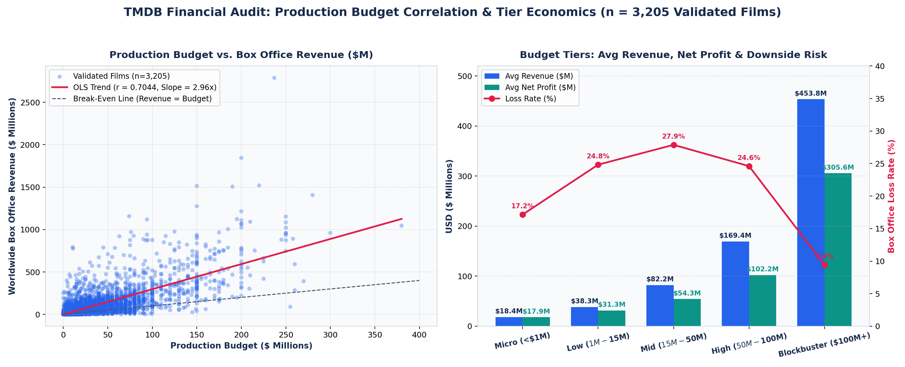
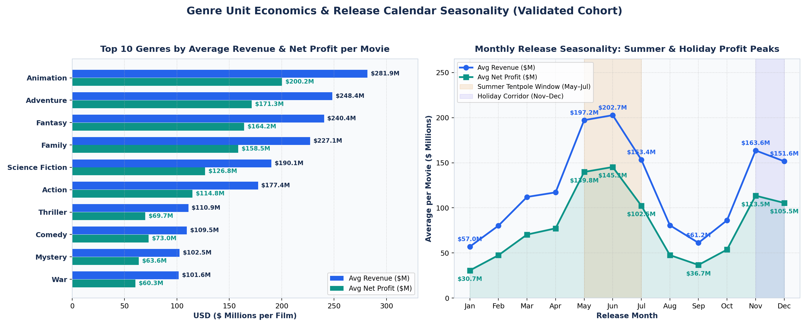
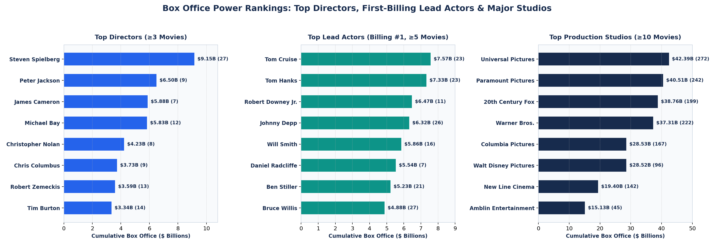
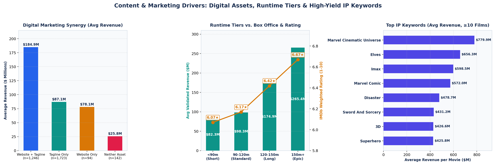

# 🎬 TMDB 5000 Box Office Economics, Talent Bankability & Studio ROI Audit (1916–2017)


> **End-to-End Motion Picture Financial & Commercial Analytics Portfolio Project:** Multi-table JSON Normalization into a 7-Table SQLite Star Schema Warehouse (`clean_movies` + 6 relational bridge tables & 8 SQL Analytical Views), Bayesian IMDb Weighted Rating Pipeline, and a 3-Page Interactive Executive Power BI Report auditing **4,802 films ($395.10B total box office revenue; $391.47B across 3,205 financially validated releases)** from **1916 to 2017**.

---

## 📌 Table of Contents
1. [Executive Summary & Business Problem](#-executive-summary--business-problem)
2. [Key Performance Indicators (Catalog & Validated Benchmark)](#-key-performance-indicators-catalog--validated-benchmark)
3. [Interactive Power BI Dashboard Preview (3 Pages)](#-interactive-power-bi-dashboard-preview-3-pages)
4. [Repository Architecture](#-repository-architecture)
5. [Data Governance, JSON Normalization & Star Schema Pipeline](#-data-governance-json-normalization--star-schema-pipeline)
6. [SQLite Star-Schema Analytical Warehouse](#-sqlite-star-schema-analytical-warehouse)
7. [Key Analytical Insights & Python Visual Audit](#-key-analytical-insights--python-visual-audit)
8. [Strategic Recommendations for Studio Greenlighting](#-strategic-recommendations-for-studio-greenlighting)
9. [How to Run & Reproduce](#-how-to-run--reproduce)

---

## 🎯 Executive Summary & Business Problem

Capital allocation in the global motion picture industry is characterized by extreme skewness, high upfront production commitments (**$139.50B** catalog budget), and complex multi-entity attribution across genres, studios, A-list talent, and seasonal release windows. Raw metadata from **The Movie Database (TMDB)** (`tmdb_5000_movies.csv` and `tmdb_5000_credits.csv`) stores critical relational attributes—such as genres, cast, crew, studios, countries, and plot keywords—as deeply nested JSON strings alongside unflagged financial anomalies (`$0` budgets and revenues).

This project resolves four core analytical and data engineering challenges for studio executives and film investment analysts:
1. **Data Hygiene & Financial Validation Gate:** Audited **4,803 raw records** to remediate explicit missing values (`runtime`, `release_date`), isolated **1,037 zero-budget** and **1,427 zero-revenue** records, and established a strict financial validation gate (`has_valid_financials = 1` where `budget >= $10,000` and `revenue >= $10,000`), yielding **3,205 financially verified films** for distortion-free ROI and profit modeling.
2. **Relational Star-Schema Engineering:** Built a custom Python JSON-unpacking engine to normalize nested arrays into **6 relational dimension tables** (`movie_genres`, `movie_companies`, `movie_cast`, `movie_crew`, `movie_countries`, `movie_keywords`) linked to the central `clean_movies` fact table (**111,066 total relational rows**) inside `tmdb_5000.db` and exported directly to `PowerBI_Data/` for Power BI star-schema modeling.
3. **Capital Allocation, Genre & Seasonal Window Optimization:** Quantified budget-to-revenue scaling (`r = 0.7044`), downside loss probability across 5 budget tiers, unit economics across genres, and seasonal profit peaks (`Summer Tentpole` vs. `Holiday Corridor`).
4. **Talent Bankability, Studio Share & Marketing Drivers:** Evaluated cumulative and per-film box office returns for directors (`job = 'Director'`), first-billing lead actors (`billing_order = 1`), and major studios, while isolating the commercial lift of official websites (`homepage`), marketing taglines, runtime tiers, and franchise IP keywords.

---

## 📊 Key Performance Indicators (Catalog & Validated Benchmark)

| Metric | Full Catalog (`n = 4,802` / `4,796` BI Active) | Financially Validated Cohort (`n = 3,205`) | Analytical & Operational Context |
| :--- | :---: | :---: | :--- |
| **Total Box Office Revenue** | **$395.10B** (`$395bn` in BI) | **$391.47B** | Validated gate: `budget >= $10K` & `revenue >= $10K` |
| **Total Production Budget** | **$139.50B** (`$139bn` in BI) | **$131.17B** | Excludes 1,037 zero-budget & 1,427 zero-revenue entries |
| **Net Box Office Profit** | **$255.59B** (`$256bn` in BI) | **$260.30B** | **75.79%** of validated releases achieve positive net profit |
| **Average Movie Budget** | $29.05M | **$40.93M** | Ranges from micro-indie (`<$1M`) to tentpoles (`$100M+`) |
| **Average Movie Revenue** | $82.28M | **$122.14M** | Strong budget-to-revenue linear correlation (**`r = 0.7044`**) |
| **Average Net Profit per Film** | $53.23M | **$81.22M** | Budget-to-profit correlation: **`r = 0.5491`** |
| **Return on Investment (ROI)** | **1,012.46%** (Mean ROI) | **198.44%** (Portfolio ROI) | Mean movie ROI driven by breakout micro-budget hits (`r = -0.0312`) |
| **Audience Rating & Runtime** | **6.22 / 10.0** (IMDb Weighted) | **107.63 mins** (Avg Runtime) | Raw vote average (`C = 6.09`), 70th-percentile vote threshold (`m`) |

---

## 🖥️ Interactive Power BI Dashboard Preview (3 Pages)

The interactive Power BI report ([`04_PowerBI_Dashboard/TMDB.pbix`](04_PowerBI_Dashboard/TMDB.pbix) and PDF export [`04_PowerBI_Dashboard/TMDB.pdf`](04_PowerBI_Dashboard/TMDB.pdf)) is styled with the custom **Cinematic Executive Navy Theme** ([`TMDB_Executive_Theme.json`](04_PowerBI_Dashboard/TMDB_Executive_Theme.json)) and structured across three executive views:

### Page 1: Executive & Financial Overview


### Page 2: Talent, Studios & Global Markets


### Page 3: Content, Marketing & Audience Drivers


---

## 📂 Repository Architecture

```text
TMDB-Box-Office-Financial-Analytics/
│
├── 01_Data/
│   ├── Raw_Data/
│   │   ├── tmdb_5000_movies.csv                      # Raw TMDB movies dataset (4,803 rows x 20 columns)
│   │   └── tmdb_5000_credits.csv                     # Raw TMDB cast & crew JSON dataset (4,803 rows x 4 columns)
│   └── PowerBI_Data/                                 # Normalized Star-Schema CSV tables for Power BI modeling
│       ├── clean_movies.csv                          # Central Fact Table (4,802 movies x 22 engineered columns)
│       ├── movie_genres.csv                          # Unpacked Genre bridge table (12,160 rows)
│       ├── movie_companies.csv                       # Top-3 Production Studios bridge table (10,162 rows)
│       ├── movie_cast.csv                            # Top-5 Billed Cast bridge table (23,594 rows)
│       ├── movie_crew.csv                            # Directors, Producers & Writers bridge table (17,718 rows)
│       ├── movie_countries.csv                       # Production Countries bridge table (6,436 rows)
│       └── movie_keywords.csv                        # Thematic & IP Keywords bridge table (36,194 rows)
│
├── 02_SQL_Warehouse/
│   ├── tmdb_5000.db                                  # SQLite Star-Schema Warehouse (7 relational tables + 8 Views)
│   └── TMDB_Analytical_Views.sql                     # Standalone SQL DDL & 8 analytical view definitions
│
├── 03_Python_Pipeline/
│   └── TMDB.ipynb                                    # End-to-end ETL, JSON normalization, SQL queries & EDA
│
├── 04_PowerBI_Dashboard/
│   ├── TMDB.pbix                                     # 3-Page Interactive Executive Power BI Report
│   ├── TMDB.pdf                                      # 3-Page PDF Export of the Executive Dashboard
│   └── TMDB_Executive_Theme.json                     # Custom "Cinematic Executive Navy Theme" JSON
│
├── 05_Visuals/
│   ├── dashboard_preview1.png                        # Power BI Page 1: Executive & Financial Overview
│   ├── dashboard_preview2.png                        # Power BI Page 2: Talent, Studios & Global Markets
│   ├── dashboard_preview3.png                        # Power BI Page 3: Content, Marketing & Audience Drivers
│   ├── 01_Budget_Tiers_Financial_Correlation.png     # Python Visual 1: Budget vs Revenue Scatter & Tier Risk
│   ├── 02_Genre_Economics_Seasonality_Curve.png      # Python Visual 2: Genre Unit Economics & Monthly Seasonality
│   ├── 03_Talent_Studios_Power_Rankings.png          # Python Visual 3: Top Directors, Lead Actors & Studios
│   └── 04_Content_Marketing_Runtime_Drivers.png      # Python Visual 4: Marketing Synergy, Runtime & IP Keywords
│
├── .gitignore
└── README.md
```

---

## 🛠️ Data Governance, JSON Normalization & Star Schema Pipeline

### 1. Data Quality Audit & Anomaly Remediation
Merging `tmdb_5000_movies.csv` and `tmdb_5000_credits.csv` on movie `id` yielded **4,803 films across 22 raw attributes**. Initial profiling uncovered three classes of data quality issues:
- **Explicit Nulls:** `homepage` (3,091 missing / **64.36%**), `tagline` (844 missing / **17.57%**), `overview` (3 missing / **0.06%**), `runtime` (2 missing / **0.04%**), and `release_date` (1 missing / **0.02%** — dropped to preserve temporal integrity, leaving **4,802 valid films**).
- **Hidden Zero Anomalies:** **1,037 movies** recorded `$0` budget, **1,427 movies** recorded `$0` revenue, **35 movies** recorded `0` runtime (remediated by imputing the catalog median runtime after converting `0` to `NaN`), and **411 movies** had `<10` audience votes.
- **Empty JSON Arrays (`'[]'`):** `keywords` (**412 empty / 8.58%**), `production_companies` (**351 empty / 7.31%**), `production_countries` (**174 empty / 3.62%**), `spoken_languages` (**86 empty / 1.79%**), `cast` (**43 empty / 0.90%**), `genres` (**28 empty / 0.58%**), and `crew` (**28 empty / 0.58%**).

### 2. Engineered Financial, Marketing & Bayesian Rating Features (`clean_movies`)
- **Financial Validation Gate (`has_valid_financials`):** Binary flag (`1` if `budget >= $10,000` and `revenue >= $10,000`, else `0`), isolating **3,205 verified films** to prevent `$0` placeholders from corrupting `profit` (`revenue - budget`) and `roi_pct` (`(revenue - budget) / budget × 100`).
- **IMDb Bayesian Weighted Rating (`weighted_rating`):** Mitigates low-vote distortion (411 films have `<10` votes) using the official Bayesian shrinkage formula:
  $$\text{Weighted Rating} = \left(\frac{v}{v+m} \cdot R\right) + \left(\frac{m}{v+m} \cdot C\right)$$
  where $v$ is the movie's `vote_count`, $R$ is the movie's `vote_average`, $C = 6.09$ is the catalog mean rating, and $m$ is the 70th-percentile vote count threshold.
- **Temporal & Marketing Indicators:** Extracted `release_year`, `release_month`, `has_homepage` (`0/1`), `has_tagline` (`0/1`), and `title_word_count`.

### 3. Multi-Table Relational Star Schema (`1 Fact + 6 Dimension Tables`)
Using `unpack_json_to_table()`, nested JSON fields were unpacked, deduplicated, and persisted to SQLite (`tmdb_5000.db`) and `PowerBI_Data/`:
- **`clean_movies` (4,802 rows × 22 cols):** Central fact table with raw JSON columns stripped for lean query execution.
- **`movie_genres` (12,160 rows):** Full 1-to-many mapping of `movie_id` to `genre_name`.
- **`movie_companies` (10,162 rows):** Top-3 lead production studios per movie (`max_items=3`).
- **`movie_cast` (23,594 rows):** Top-5 billed stars per movie (`max_items=5`) with explicit `billing_order` (`1` = First-Billing Lead Star).
- **`movie_crew` (17,718 rows):** Filtered core creative leadership (`job_role IN ('Director', 'Producer', 'Writer')`).
- **`movie_countries` (6,436 rows):** Co-production country mapping (`country_name`).
- **`movie_keywords` (36,194 rows):** Granular plot tropes, franchise tags, and format identifiers (`keyword_name`).

---

## 🗄️ SQLite Star-Schema Analytical Warehouse

In addition to the 7 normalized Star Schema tables, `02_SQL_Warehouse/tmdb_5000.db` includes **8 pre-built SQL analytical views** (defined in [`02_SQL_Warehouse/TMDB_Analytical_Views.sql`](02_SQL_Warehouse/TMDB_Analytical_Views.sql)):

| SQL View Name | Analytical Purpose |
| :--- | :--- |
| `vw_executive_financial_kpis` | Reconciles full-catalog (`4,802` films) vs. validated-cohort (`3,205` films) budget, revenue, profit, ROI, and ratings. |
| `vw_budget_tier_economics` | Aggregates movie count, average budget, revenue, profit, portfolio ROI, and loss rate across the 5 budget tiers. |
| `vw_genre_performance_matrix` | Ranks all movie genres by unit economics (average revenue/profit per film), total gross, popularity, and rating. |
| `vw_seasonal_release_strategy` | Evaluates monthly (`1–12`) and seasonal (`Summer Tentpole`, `Holiday Corridor`, `Spring`, `Off-Peak`) profitability. |
| `vw_top_directors_leaderboard` | Ranks directors (`job_role = 'Director'`, `≥3` validated films) by total box office, per-movie average, rating, and ROI. |
| `vw_top_lead_actors_bankability` | Isolates #1 first-billing lead actors (`billing_order = 1`, `≥5` films) to measure true star-driven box office power. |
| `vw_studio_market_share` | Audits major production houses (`≥10` validated films) across volume, total gross, per-film revenue, and rating. |
| `vw_marketing_content_drivers` | Cross-tabulates official website (`has_homepage`), tagline (`has_tagline`), and `runtime_tier` against revenue and popularity. |

---

## 📈 Key Analytical Insights & Python Visual Audit

### 1. Capital Allocation, Financial Correlations & Budget Tier Risk


| Budget Tier | Validated Movies | Avg Budget | Avg Box Office Revenue | Avg Net Profit | Aggregate Tier ROI | Box Office Loss Rate |
| :--- | :---: | :---: | :---: | :---: | :---: | :---: |
| **1. Micro Budget (`< $1M`)** | 99 | $0.43M | $18.35M | $17.92M | **4,167.17%** | 17.17% |
| **2. Low Budget (`$1M – $15M`)** | 898 | $6.93M | $38.28M | $31.34M | 452.07% | 24.83% |
| **3. Mid Budget (`$15M – $50M`)** | **1,252** | $27.89M | $82.21M | $54.31M | 194.71% | **27.88%** |
| **4. High Budget (`$50M – $100M`)** | 638 | $67.18M | $169.38M | $102.21M | 152.14% | 24.61% |
| **5. Blockbuster (`$100M+`)** | 318 | **$148.18M** | **$453.75M** | **$305.57M** | **206.22%** | **9.43%** |

- **Strong Linear Scale (`r = 0.7044`), Zero ROI Scale (`r = -0.0312`):** Production budget correlates strongly with gross revenue (**`0.7044`**) and net dollar profit (**`0.5491`**), while audience engagement—specifically **Vote Count (`r = 0.7556`)** and **Popularity (`r = 0.6011`)**—serves as the strongest post-release proxy for ticket sales. Conversely, budget has virtually zero correlation with percentage ROI (**`-0.0312`**) because viral micro-budget films (`<$1M`) achieve extreme percentage multiples (**4,167.17%** tier ROI).
- **The "Mid-Budget Valley of Death" vs. Blockbuster Safety:** `Mid Budget ($15M–$50M)` represents the largest production volume (**1,252 films**) but suffers the **highest commercial failure rate (27.88% lose money)**. In contrast, `Blockbuster ($100M+)` releases (**318 films**) benefit from established franchise IP and global distribution, cutting the loss rate to just **9.43%** while generating **$305.57M** in average net profit (**206.22%** aggregate ROI).

---

### 2. Genre Unit Economics & Release Calendar Seasonality


| Genre Rank (by Avg Revenue) | Validated Movies | Total Gross ($B) | Avg Budget ($M) | Avg Revenue ($M) | Avg Net Profit ($M) | Avg Popularity | Weighted Rating |
| :--- | :---: | :---: | :---: | :---: | :---: | :---: | :---: |
| **1. Animation** | 186 | $52.44B | $81.70M | **$281.92M** | **$200.22M** | **46.75** | **6.43** |
| **2. Adventure** | 659 | **$163.67B** | $77.09M | $248.36M | $171.27M | 45.59 | 6.28 |
| **3. Fantasy** | 339 | $81.50B | $76.23M | $240.43M | $164.19M | 43.22 | 6.25 |
| **4. Family** | 363 | $82.43B | $68.55M | $227.07M | $158.53M | 36.56 | 6.27 |
| **5. Science Fiction** | 428 | $81.36B | $63.25M | $190.09M | $126.84M | 43.51 | 6.27 |
| **6. Action** | **915** | $162.32B | $62.60M | $177.39M | $114.80M | 37.33 | 6.22 |

- **Animation Leads Unit Profitability, Adventure & Action Lead Total Volume:** While **Adventure ($163.67B across 659 films)** and **Action ($162.32B across 915 films)** dominate aggregate market volume, **Animation** is the #1 genre on a per-film basis—averaging **$281.92M in revenue** and **$200.22M in net profit** per release with the highest audience popularity (**46.75**) and rating (**6.43**).
- **Bimodal Seasonal Profit Windows:** Release timing creates a nearly **4.7x spread** in average movie profitability:
  - **Summer Tentpole Peak (`June & May`):** **June** ranks #1 overall (**$202.71M avg revenue / $145.26M avg profit** across 291 films), closely followed by **May** (**$197.20M avg revenue / $139.80M avg profit**) and **July** (**$153.39M avg revenue / $102.47M avg profit**).
  - **Holiday Corridor (`November & December`):** **November** (#3 overall at **$163.61M avg revenue / $113.50M avg profit**) and **December** (#4 at **$151.64M avg revenue / $105.49M avg profit**) capture awards-season and family holiday demand.
  - **Dump Months (`January & September`):** **January** averages just **$57.02M revenue ($30.67M profit)**, while **September** records the highest release crowding (**380 films**) but the second-lowest profit (**$36.73M**).
  - **Launch Day Strategy:** Across the week, **Friday ($110.16B across 2,053 films)**, **Wednesday ($109.40B across 795 films — highest per-film average at $137.61M)**, and **Thursday ($86.05B)** capture **77.4%** of global box office revenue.

---

### 3. Talent Bankability, Studio Market Share & Global Production Hubs


| Top Directors (`≥3 Films`) | Films | Total Gross | Avg / Film | Rating | Top Lead Actors (`Billing #1, ≥5 Films`) | Lead Roles | Total Gross | Avg / Film | Top Studios (`≥10 Films`) | Films | Total Gross | Avg / Film |
| :--- | :---: | :---: | :---: | :---: | :--- | :---: | :---: | :---: | :--- | :---: | :---: | :---: |
| **Steven Spielberg** | **27** | **$9,147.39M** | $338.79M | 6.78 | **Tom Cruise** | 23 | **$7,570.39M** | $329.15M | **Universal Pictures** | **272** | **$42,394.60M** | $155.86M |
| **Peter Jackson** | 9 | $6,498.64M | $722.07M | 7.15 | **Tom Hanks** | 23 | $7,330.45M | $318.72M | **Paramount Pictures** | 242 | $40,514.73M | $167.42M |
| **James Cameron** | 7 | $5,883.57M | **$840.51M** | 7.13 | **Robert Downey Jr.** | 11 | $6,469.50M | $588.14M | **20th Century Fox** | 199 | $38,757.79M | $194.76M |
| **Michael Bay** | 12 | $5,832.52M | $486.04M | 6.32 | **Johnny Depp** | 26 | $6,319.73M | $243.07M | **Warner Bros.** | 222 | $37,306.29M | $168.05M |
| **Christopher Nolan** | 8 | $4,227.48M | $528.44M | **7.65** | **Will Smith** | 16 | $5,859.43M | $366.21M | **Columbia Pictures** | 167 | $28,526.53M | $170.82M |
| **Chris Columbus** | 9 | $3,725.63M | $413.96M | 6.57 | **Daniel Radcliffe** | 7 | $5,538.79M | **$791.26M** | **Walt Disney Pictures** | 96 | $28,515.76M | **$297.04M** |

- **Director & Lead Actor Alpha:** **Steven Spielberg** leads cumulative box office (**$9.15B** across 27 films, **1,021.11% avg ROI**), **James Cameron** commands the highest per-film average (**$840.51M**), **Christopher Nolan** achieves the highest critical consensus (**7.65 weighted rating** across 8 films), and **George Lucas** leads percentage return (**5,332.84% avg ROI**). Among first-billing lead actors (`billing_order = 1`), **Tom Cruise ($7.57B)** and **Tom Hanks ($7.33B)** lead career volume, while **Daniel Radcliffe ($791.26M/film)** and **Robert Downey Jr. ($588.14M/film)** lead per-movie franchise draw.
- **Studio Scale vs. Hit Efficiency:** The "Big Six" studios—**Universal ($42.39B)**, **Paramount ($40.51B)**, **20th Century Fox ($38.76B)**, **Warner Bros. ($37.31B)**, **Columbia ($28.53B)**, and **Walt Disney ($28.52B)**—anchor industry output. However, **Amblin Entertainment ($336.16M/film, 6.52 rating)** and **Walt Disney Pictures ($297.04M/film across 96 releases)** generate nearly **2x** the per-movie revenue of high-volume studios.
- **Global Hubs & Language Economics:** The **United States ($377.07B, 2,891 films)** and **United Kingdom ($59.61B, 429 films)** dominate production volume, while **New Zealand ($8.33B across 21 films)** achieves the highest per-movie average (**$396.45M**) due to *Lord of the Rings* / *The Hobbit* co-productions. **English (`en`)** accounts for **98.6% ($390B)** of catalog revenue (**$125.43M** validated avg vs. **$41.24M** for Non-English), though **Non-English films achieve superior critical ratings (6.45 vs. 6.27)**.

---

### 4. Digital Marketing Synergy, Runtime Tiers & High-Yield IP Keywords


- **7.1x Digital Marketing Lift (`Official Website + Tagline`):** Validated films backed by both a dedicated official website (`has_homepage = 1`) and a promotional tagline (`has_tagline = 1`) (`n = 1,246`) generate **$184.92M in average revenue** and **41.18 popularity**—compared to **$87.09M** for tagline-only films (`n = 1,723`), **$78.06M** for website-only films (`n = 94`), and just **$25.84M** (`9.46` popularity) for films lacking both assets (`n = 142`). Across the full catalog, movies with a promotional tagline capture **97.1% ($384B)** of all box office dollars.
- **Epic Runtime Premium (`150m+`):** Longer runtimes correlate positively with both critical reception and box office yield:
  - `1. Under 90 mins` (670 films): **$82.28M** validated avg revenue (`$41M` catalog avg) · **6.07** weighted rating
  - `2. Standard (90–120m)` (3,059 films): **$98.34M** validated avg revenue (`$65M` catalog avg) · **6.17** weighted rating
  - `3. Long (120–150m)` (894 films): **$174.94M** validated avg revenue (`$153M` catalog avg) · **6.42** weighted rating
  - `4. Epic (150m+)` (179 films): **$265.44M** validated avg revenue (`$222M` catalog avg) · **6.67** weighted rating
- **Franchise IP Keywords & Title Length:** Among keywords appearing in `≥10` validated films, **`marvel cinematic universe` ($779.88M avg, 6.95 rating)**, **`elves` ($656.30M, 6.99 rating)**, **`imax` ($598.46M)**, **`marvel comic` ($571.97M)**, and **`3d` ($426.61M across 91 films)** lead per-movie earnings, while post-credits stingers (`duringcreditsstinger` **$58B total**, `aftercreditsstinger` **$38B total**) dominate cumulative franchise gross. Consequently, **long descriptive franchise titles (`5+ Words`, $164.57M validated avg)** outperform `3–4 Words` (**$122.33M**) and `1–2 Words` (**$111.53M**).

---

## 💡 Strategic Recommendations for Studio Greenlighting

1. **Barbell Capital Allocation (Avoid the `$15M–$50M` Mid-Budget Trap):**
   - Reallocate capital away from standalone mid-budget productions (**27.88% loss rate**) toward a barbell strategy: pair high-upside **Low/Micro-Budget genre films (`<$15M`, 452%–4,167% ROI)** in Horror/Thriller with **Franchise Tentpoles (`$100M+`, 9.43% loss rate, $305.57M avg profit)** anchored in Animation, Adventure, and Sci-Fi/Fantasy.
2. **Concentrate Tentpole Launches in Wednesday–Friday Summer & Holiday Corridors:**
   - Schedule high-budget releases for **May–June (`$139.8M–$145.3M` avg profit)** or **November–December (`$105.5M–$113.5M` avg profit)** with **Wednesday (`$137.61M` avg gross)** or **Friday (`$110.16B` total volume)** theatrical openings to maximize word-of-mouth velocity (`vote_count` correlation **`r = 0.7556`**), while avoiding overcrowded **September (`$36.73M` avg profit)** and **January (`$30.67M` avg profit)** windows.
3. **Mandate Full-Funnel Digital Marketing & Premium Format Integration:**
   - Require dedicated web hubs (`homepage`), colon-structured franchise subtitle branding (`5+ words` when extending IP), post-credits stingers (`duringcreditsstinger` / `aftercreditsstinger`), and **IMAX / 3D** large-format partnerships (**$426.6M–$598.5M avg revenue**).
4. **Protect Creative Runtime for Prestige & Event Releases:**
   - Avoid forcefully cutting tentpole or prestige narratives below 120 minutes; `Long (120–150m)` and `Epic (150m+)` releases deliver **+78% to +170% higher validated box office revenue** (**$174.94M–$265.44M** vs. **$98.34M** for standard `90–120m` films) alongside a **+0.25 to +0.50 star lift** in IMDb weighted ratings.

---

## 🚀 How to Run & Reproduce

1. **Clone the Repository:**
   ```bash
   git clone https://github.com/beshomagdy2050/TMDB-Box-Office-Financial-Analytics.git
   cd TMDB-Box-Office-Financial-Analytics
   ```
2. **Run the Python ETL & Analytical Pipeline (`Jupyter Notebook`):**
   ```bash
   pip install pandas numpy matplotlib seaborn
   jupyter notebook 03_Python_Pipeline/TMDB.ipynb
   ```
3. **Query the SQLite Star-Schema Warehouse:**
   - Open `02_SQL_Warehouse/tmdb_5000.db` in **DB Browser for SQLite**, **DBeaver**, or via Python `sqlite3`, or execute the DDL and 8 analytical view queries in [`02_SQL_Warehouse/TMDB_Analytical_Views.sql`](02_SQL_Warehouse/TMDB_Analytical_Views.sql).
4. **Explore the Interactive Power BI Dashboard:**
   - Open [`04_PowerBI_Dashboard/TMDB.pbix`](04_PowerBI_Dashboard/TMDB.pbix) in **Microsoft Power BI Desktop** (or view the 3-page static export in [`04_PowerBI_Dashboard/TMDB.pdf`](04_PowerBI_Dashboard/TMDB.pdf)).
   - To apply the custom executive palette in other reports, import [`04_PowerBI_Dashboard/TMDB_Executive_Theme.json`](04_PowerBI_Dashboard/TMDB_Executive_Theme.json) via **View → Themes → Browse for themes**.
